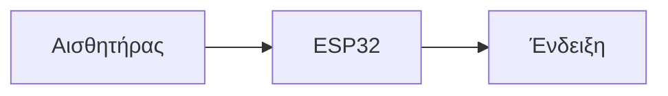

# Συντήρηση m0ss1

Το site χρησιμοποιεί Jekyll 4.4.1 και ολόκληρο το επίσημο Chirpy 7.6.0 με native αριστερό μενού, κάρτες, breadcrumbs, δεξιά περιεχόμενα, σχετικά άρθρα και light/dark. Source: master. Δημοσίευση compiled output: gh-pages με .nojekyll. Τα παλιά URLs διατηρούνται.

## Προσθήκη άρθρου

Αντέγραψε το `templates/new-post.md.example` στο `_posts/2026-10-22-esp32-sensor.md`. Συμπλήρωσε πραγματική ημερομηνία και ώρα, τίτλο, description, categories και tags. Για παράδειγμα:

```yaml
layout: post
title: Αισθητήρας θερμοκρασίας με ESP32
date: 2026-10-22 18:00:00 +0200
description: Σύνδεση και ανάγνωση αισθητήρα με ESP32.
categories: [Arduino]
tags: [esp32, αισθητήρες]
toc: true
pin: false
```

Χρησιμοποίησε πραγματική εικόνα στο image.path/alt ή αφαίρεσε το image block. Γράψε σύντομη εισαγωγή και ενότητες `##` / `###`: δημιουργούν αυτόματα anchors και δεξιό πίνακα περιεχομένων. Μελλοντικές ημερομηνίες δεν δημοσιεύονται πριν από την ώρα τους. Το pin:true εμφανίζει το άρθρο πρώτο. Αρχική, κατηγορίες, tags, αρχείο και αναζήτηση διαβάζουν τα `_posts`· μην βάζεις άρθρα στα `_tabs`.

## Οδηγός ρομπότ

Μοναδική πηγή: `_posts/2026-10-21-robot-4wd.html`, permalink `/robot/`, πραγματική πρώτη δημοσίευση 2026-10-21T13:28:31Z. Διατήρησε `layout: post`, `robot: true`, `toc: true`, `pin: true`: ο native script selector απαιτεί post layout. Το κείμενο και τα διαγράμματα βρίσκονται στο `_includes/robot/`, τα πραγματικά ZIP/PNG/CSS/JS στο `assets/robot/`. Δεν υπάρχουν λήψεις model.py/check.py/MP3· μην επινοήσεις αρχεία.

Διατήρησε τα 17 guide-section heading IDs και guide-downloads. Τα HTML h2/h3 απαιτούν μοναδικό id. Έλεγξε πραγματικό κλικ στα δεξιά περιεχόμενα για διάγραμμα, harness, πίνακα, σημειώσεις, firmware και λήψεις. Διατήρησε pins, πολικότητα, 36 συνδέσεις, SVG/data-w και JavaScript WD/PARTS_OF σε συμφωνία. Το robot έλειπε από την αρχική λόγω διαφορετικού collection, όχι λόγω draft ή ημερομηνίας.

## Εμφάνιση και πλοήγηση

Κεντρικές ρυθμίσεις `_config.yml`: title, tagline, avatar, theme_mode και lang: el-GR για το πραγματικό ελληνικό locale. Στατικές σελίδες `_tabs/` με layout:page/title/icon/order/permalink. Το sidebar προέρχεται αυτούσιο από το επίσημο gem. Το robot δεν εμφανίζεται ως ξεχωριστή καταχώριση εκεί: είναι κανονικό pinned άρθρο. Τα υπόλοιπα layouts, styles και scripts προέρχονται από το κλειδωμένο theme gem. Μην επαναφέρεις custom editorial shell.

Δεν υπάρχει τοπικό override του default layout ή του sidebar· χρησιμοποιούνται τα πραγματικά 7.6 layouts. Το metadata-hook φορτώνει scoped guide assets μόνο στο robot. Το content-fixes.css διορθώνει την αντίθεση παλιών inline μπλε τίτλων. Μην προσθέτεις SCSS override χωρίς συγκεκριμένη ανάγκη. Η 7.6 χρησιμοποιεί πλέον Sass @use, όχι το παλιό @import. Το /search/ χρησιμοποιεί το native πεδίο αναζήτησης χωρίς διπλά input IDs.

## Build και δημοσίευση

```sh
JEKYLL_ENV=production GEM_HOME=/home/Codex-Robot/.local/robot-gems GEM_PATH=/home/Codex-Robot/.local/robot-gems BUNDLE_PATH=/home/Codex-Robot/.local/robot-bundle /home/Codex-Robot/.local/robot-gems/bin/bundle exec jekyll build
```

Πριν από PR/merge/deployment: επιτυχές build και ανεξάρτητος πραγματικός οπτικός έλεγχος αρχικής, robot, κατηγορίας και παλιού άρθρου σε κινητό/tablet/desktop. Άνοιξε screenshots, έλεγξε ελληνικά, sidebar, δεξί TOC με κλικ, light/dark, εικόνες, διαγράμματα, πίνακες, downloads, αναζήτηση και οριζόντια υπερχείλιση. Δημοσίευσε το ελεγμένο `_site` στο gh-pages, διατηρώντας άσχετα paths και τις προστασίες repository· επαλήθευσε το δημόσιο site μετά το deployment.

Το παλιό workflow αφορά main/posts, ενώ το source είναι master. Το root sw.js αποσύρει μόνο chirpy- caches και root registration· το unregister override περιορίζεται στο root scope. Άλλα scopes/cache namespaces, `/gym-app` και Supabase δεν αγγίζονται. PWA:false αποφεύγει stale HTML. Templates, work-notes και οδηγίες εξαιρούνται από το generated site.

## Πλήρης επίσημη βάση 7.6.0

Πηγή: https://github.com/cotes2020/jekyll-theme-chirpy/tree/v7.6.0, tag commit 152093879e6319dac342454d8df75a3c3572315f. Οπτική αναφορά: https://chirpy.cotes.page/. Το Gemfile κλειδώνει ακριβώς 7.6.0 και το Gemfile.lock διατηρεί τις πραγματικές εξαρτήσεις. Τα layouts, Bootstrap styles και τα επτά native JS bundles προέρχονται από το gem, όχι από τοπική ανακατασκευή. Δεν εισάγουμε demo άρθρα στο πραγματικό site.

Το body χρησιμοποιεί Source Sans Pro και οι τίτλοι Lato. Το guide κείμενο και τα headings κληρονομούν την ίδια native τυπογραφία, ενώ τα SVG labels μένουν αμετάβλητα. Η Google CSS δεν παρέχει Greek Lato subset· το assets/css/greek-fonts.css προσθέτει μόνο τους ελληνικούς χαρακτήρες από τα αυθεντικά Lato-Regular/Light.ttf. Πηγές, SHA256 και άδεια OFL: assets/fonts/lato/. Δεν αλλάζουμε τα font outlines.

Το επίσημο sidebar έχει Light/Dark/System dropdown και data-bs-theme. Τα άρθρα έχουν desktop sticky TOC και native mobile Contents popup, περιγραφή, author/read time, related posts, κατηγορίες/tags, share/copy-link και προηγούμενο/επόμενο. Η αναζήτηση, pagination, αρχείο, image GLightbox, native lazy loading, code highlighting/copy buttons, prompts και footnotes υποστηρίζονται από το theme. Κανένα πρόσθετο clone αυτών των συστημάτων δεν απαιτείται.

Το footer.html κρατά το επίσημο markup/spacing και εμφανίζει μόνο το m0ss1 copyright/δικαιώματα. Το ορατό attribution αφαιρέθηκε από το template, όχι με CSS hiding. Οι άδειες διατηρούνται σε LICENSE και LICENSE.chirpy-7.6. Η ελληνική μετάφραση και τα aliases τίτλων των υπαρχόντων tabs βρίσκονται στο _data/locales/el-GR.yml.

Νέα πεδία config: cdn (κενό για δικά μας assets), comments.provider και analytics. Οι integrations υποστηρίζονται αλλά χρειάζονται πραγματικά δικά σου account IDs· μην αντιγράφεις IDs από το demo. Τα PWA/cache παραμένουν σκόπιμα ανενεργά για απομόνωση του /gym-app, καθώς ο stock worker καθαρίζει και άλλα cache namespaces. Μελλοντική ενεργοποίηση απαιτεί namespaced worker και πραγματικό preservation test. Supabase εκτός εργασίας.

### Mermaid, μαθηματικά και κώδικας

Για διάγραμμα βάλε mermaid: true στο frontmatter και:



Για μαθηματικά βάλε math: true και γράψε `$$ E = mc^2 $$`. Οι βιβλιοθήκες φορτώνονται μόνο στις αντίστοιχες σελίδες. Έλεγξε την απόδοση στον browser πριν δημοσίευση.

Για code highlighting/copy button:

```cpp
const int ledPin = 4;
```

Τα ## και ### δημιουργούν αυτόματα περιεχόμενα. Για dark-mode εικόνες, responsive εικόνες, prompts, footnotes και video χρησιμοποίησε την επίσημη τεκμηρίωση Writing a New Post / Text and Typography, διατηρώντας πραγματικά αρχεία. Δεν χρειάζεται demo περιεχόμενο στην αρχική.

Ο οπτικός έλεγχος συγκρίνει με το επίσημο demo και ελέγχει τις πραγματικές platform fonts, όχι μόνο το CSS font-family. Native mobile Contents και desktop TOC απαιτούν πραγματικά clicks και screenshots μετά την ολοκλήρωση της ομαλής κύλισης. Το παλιό CI παραμένει αμετάβλητο σε αυτόν τον γύρο· η εγκεκριμένη δημοσίευση γίνεται από το ελεγμένο compiled output στο gh-pages.
